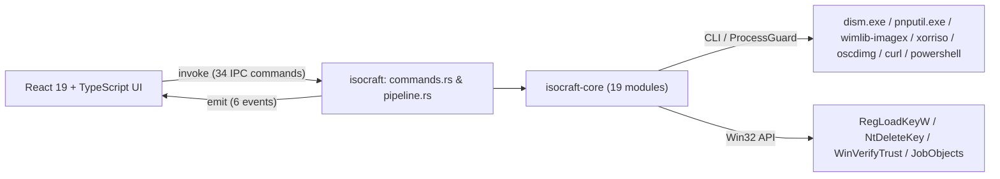
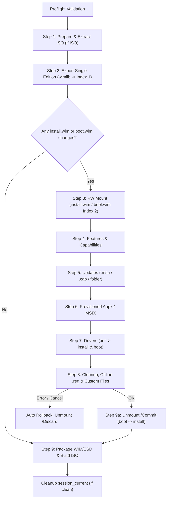

# Архитектура ISOCraft

Документ описывает внутреннюю архитектуру приложения **ISOCraft**, структуру frontend и backend (Rust workspace), 9-шаговый пайплайн сборки, полный IPC-контракт Tauri v2, систему восстановления после сбоев и модель безопасности.

---

## Содержание

- [1. Общая архитектура](#1-общая-архитектура)
- [2. Структура Backend (`src-tauri/`)](#2-структура-backend-src-tauri)
- [3. Структура Frontend (`src/`)](#3-структура-frontend-src)
- [4. 9-шаговый пайплайн сборки (`start_build`)](#4-9-шаговый-пайплайн-сборки-start_build)
- [5. Контракт IPC (Tauri Commands и Events)](#5-контракт-ipc-tauri-commands-и-events)
- [6. Хранение данных, кеширование и Crash Recovery](#6-хранение-данных-кеширование-и-crash-recovery)
- [7. Модель безопасности и границы доверия](#7-модель-безопасности-и-границы-доверия)

---

## 1. Общая архитектура

Бэкенд разделён на два Rust-крейта (Rust edition `2024`): GUI-оболочку **`isocraft`** (Tauri v2) и чистое тестируемое ядро **`isocraft-core`** без зависимостей от GUI и нативных диалогов. Фронтенд построен на **React 19**, **TypeScript**, **Tailwind CSS v4** и **Vite 8**.



---

## 2. Структура Backend (`src-tauri/`)

### 2.1. Оболочка Tauri (`isocraft`, `src-tauri/src/`)

| Файл | Назначение |
| :--- | :--- |
| `main.rs` | Точка входа бинарника Windows (`isocraft_lib::run()`). |
| `lib.rs` | Инициализация `AppState`, WebView2 (`webview_user_data_dir()`), восстановление и сохранение геометрии окна (`windowWidth`, `windowHeight`, `windowMaximized`), перехват `WindowEvent::CloseRequested` при занятом `ProcessGuard`, регистрация **34 IPC-команд**. |
| `state.rs` | `AppState` (`settings`, `logger`, `process_guard`), `BuildConfig`, `BuildProgressEvent`, `AppsBuildPlan`, `FeaturesBuildPlan`, маппинг прогресса `log_with_progress` (`ProgressTool::Dism` / `Wimlib`), `apply_window_theme`, `cleanup_session_dir_if_clean`. |
| `commands.rs` | Обработчики `#[tauri::command]`, связывающие IPC с `isocraft-core` и `pipeline.rs`, экспорт диагностики и управление автообновлением (`tauri-plugin-updater`). |
| `pipeline.rs` | Предсборочная проверка `preflight_validate_build_config`, защита от перезаписи исходника (`paths_overlap_source`) и оркестратор 9-шагового пайплайна `run_build_pipeline`. |

### 2.2. Ядро (`isocraft-core`, `src-tauri/crates/core/src/`)

| Модуль | Ответственность |
| :--- | :--- |
| `env.rs` | Проверка elevated-прав администратора, поиск системных (`dism.exe`, `curl.exe`, `powershell.exe`, `explorer.exe`) и встроенных (`wimlib-imagex.exe`, `xorriso.exe`) утилит, поиск/проверка `oscdimg.exe` (`WinVerifyTrust`), снятие verbatim-префикса (`strip_windows_verbatim_prefix`), проверка свободного места (`< 40 ГБ`), статистика и очистка кеша/загрузок. |
| `settings.rs` | Чтение/атомарная запись `%LOCALAPPDATA%\ISOCraft\settings.json`, вычисление путей `app_data_root()` / `default_workspace_dir()` / `webview_user_data_dir()`, валидация `validate_workspace_dir`. |
| `fs_utils.rs` | Проверка симлинков/reparse-точек (`is_symlink_or_reparse`), зарезервированных имён Windows, UNC/device-путей (`is_unc_or_device_path`), ограниченное чтение (`read_file_bounded`), отменяемое копирование (`copy_file_cancellable`), атомарная запись (`write_file_atomic`) и проверка вложенности (`is_path_within_dir`). |
| `process.rs` | `ProcessGuard` (`OperationKind`, генерации `BusyScope`, флаг отмены), Windows Job Objects (`JOB_OBJECT_LIMIT_KILL_ON_JOB_CLOSE`), запуск CLI без окна (`CREATE_NO_WINDOW`) с построчным стримингом и принудительное завершение дерева процессов (`kill_process_tree` через ToolHelp). |
| `logger.rs` | Кольцевой буфер журнала сессии (`SessionLogger`, до 5000 записей) и экспорт диагностики (лог приложения + хвост `<workspace>\dism.log` до 256 КБ / 256 000 байт). |
| `image.rs` | Парсинг XML `wimlib-imagex info --xml` (`quick-xml`), автодекодирование UTF-16LE/BE/UTF-8, валидация клиентской Windows 11 x64 (`Client`, `x64`, `build >= 22000`), извлечение ISO через `Mount-DiskImage` (`extract_iso_and_export_edition` с пропуском `sources\install.*` и прямым экспортом выбранного индекса до размонтирования) и рекурсивное снятие `ReadOnly`. |
| `wim.rs` | Одноредакционный экспорт (`export_single_edition`), `mount_wim`/`unmount_wim` с журналированием в `workspace_state.json`, аварийный откат `recover_workspace_async`, упаковка итогового образа (`WIM` или `ESD` с `--compress=LZMS --solid`), парсеры прогресса DISM и wimlib. |
| `iso.rs` | Валидация `autounattend.xml` (`quick-xml`, корневой элемент `<unattend>`, стек тегов, сбор `<settings pass="...">`), генерация `sources\ei.cfg`, сборка загрузочных ISO через `oscdimg.exe` или `xorriso.exe -as mkisofs` (конвертация путей `/cygdrive/<drive>/...`, dual El Torito + `-isohybrid-gpt-basdat`). |
| `dism.rs` | Загрузка каталога редакции (`ImageCatalog`: Appx, Features, Capabilities) через однократный RO-маунт в `<workspace>\cache\ro_inspect\mount` (для `.iso`/`.esd` — через временный `ro_temp.wim`) + единый PowerShell-запрос (`query_mounted_catalog_bundle_tracked`) + `/Discard`; дисковый кеш `cache/catalog_<fnv1a64>.json` (блокируется при нечистом `workspace_state.json`). |
| `apps.rs` | Извлечение `PackageFamilyName`, словарь защищённых пакетов (`protected_appx_reason`), фильтрация зависимостей по архитектуре (`x64`/`neutral`), вызовы DISM `/Add-ProvisionedAppxPackage` и `/Remove-ProvisionedAppxPackage`. |
| `features.rs` | Включение (`/Enable-Feature`, `/All`, `/LimitAccess`, `/Source`) и отключение Optional Features; добавление (`/LimitAccess`, `/Source`) и удаление Capabilities. |
| `updates.rs` | Инспекция `.msu`/`.cab` и папок обновлений, пакетное применение 24H2+ Checkpoint CU, расшифровка кодов ошибок DISM, `run_component_cleanup` (с безопасным пропуском `0x800f0806`), реэкспорт `update_catalog`. |
| `update_catalog.rs` | Поиск (`Search.aspx`), разбор диалогов (`DownloadDialog.aspx`), пошаговая проверка редиректов (`resolve_safe_download_url`), HTTPS-only загрузка обновлений через `curl.exe` (лимиты 10 МиБ HTML / 4 ГиБ файл), проверка allowlist хостов Microsoft и подписи Authenticode во временном `.part`-файле до переименования, маппинг билдов `21H2`..`26H2`. |
| `drivers.rs` | Сканирование `.inf` и директорий драйверов, инъекция в `install.wim` и `boot.wim` Index 2 (`/Recurse`, `/ForceUnsigned`), инспекция и экспорт драйверов текущего ПК (`Get-WindowsDriver -Online`, `pnputil.exe`, `DISM /Online /Export-Driver`), удаление OEM-драйверов образа (`DISM /Remove-Driver`). |
| `post_setup.rs` | Конструктор постустановки: валидация локальных установщиков/скриптов и `winget` ID, генерация `before_logon.cmd` + `SetupComplete.cmd` (Before Logon `SYSTEM`), `first_logon.ps1` (UTF-8 BOM) + `first_logon.cmd` (First Logon `User`), запись `RunOnce` в `NTUSER.DAT` и безопасное слияние `<FirstLogonCommands>` в `autounattend.xml`. |
| `reg_parser.rs` | Парсер `.reg` v5 / `REGEDIT4` (до 64 МБ; UTF-16LE/BE/UTF-8; переносы `\`, `@`, все типы кроме `REG_LINK`), маппинг веток (`CurrentControlSet`, `HKCU`, `HKCR`, `HKU\.DEFAULT`) и dry-run предпросмотр (до 500 операций). |
| `registry.rs` | Нативная Win32 загрузка/выгрузка оффлайн-кустов (`SeBackupPrivilege`/`SeRestorePrivilege`, `RegLoadKeyW` под `ISOCRAFT_<pid>_<HIVE>`, `REG_OPTION_BACKUP_RESTORE`, `NtDeleteKey`, `RegFlushKey`, `RegUnLoadKeyW`) и защита корней кустов (`is_protected_root_delete`). |
| `files.rs` | Нормализация относительных путей назначения, защита системных путей в `install.wim` и `iso_root`, защита от прохода через NTFS junctions (`check_target_no_reparse_escape`) и копирование с политиками `Overwrite`/`Skip`. |
| `preset.rs` | Сериализация/импорт JSON-пресетов (`schemaVersion: "1.0"`), блокировка UNC-путей и аудит отсутствующих локальных файлов/папок (`find_missing_preset_paths`). |

---

## 3. Структура Frontend (`src/`)

- **`src/App.tsx`** — корневое состояние открытого образа, выбранного индекса, очередей всех разделов, темы, языка, прогресса сборки, глобальных баннеров в рабочей области (`!isAdmin`, аварийное восстановление `hasDirtyWorkspace`) и фоновой проверки обновлений приложения (через 2.5 с после запуска с индикатором на кнопке «Настройки» в `Titlebar`).
- **`src/hooks/usePresetWorkflow.ts`** — сохранение/загрузка JSON-пресетов, перепривязка (`relink`) и удаление отсутствующих локальных путей.
- **`src/hooks/useLogStore.ts`** — внешний стор журнала на базе `useSyncExternalStore` с батчингом входящих событий (`100 мс`), дедупликацией по `id` и лимитом `2000` записей.
- **`src/utils/`** — `format.ts` (`formatBytes`), `destinationValidation.ts` (клиентская проверка путей назначения и пресеты путей), `win11Version.ts` (определение ветки Windows 11 по номеру билду), `backendErrors.ts` (локализация сообщений бэкенда, XML и `.reg`), `motion.ts` (`prefersReducedMotion`).
- **`src/types/studio.ts`** — единый TypeScript-контракт IPC-структур и пресетов.
- **`src/i18n/`** — конфигурация `i18next` (`index.ts`, `i18next.d.ts`) и словари `locales/{ru,en}.json`.
- **`src/components/`** — `Titlebar.tsx` (40px, переключатель `RU | EN`, цикл тем, индикатор обновления на кнопке настроек), `Sidebar.tsx` (220px, анимированные индикаторы и бейджи очередей) + `SidebarIcons.tsx`, `StatusBar.tsx` (48px), `LogDrawer.tsx` (виртуальный список логов с поиском и фильтром), `FluentModal.tsx`, `FluentMotion.tsx`, `SettingsModal.tsx` (ленивая загрузка через `React.lazy`), `CloseGuardModal.tsx`, `ConfirmResetModal.tsx` (подтверждение сброса очередей при смене образа/редакции), `ErrorBoundary.tsx`.
- **`src/components/screens/`** — 9 экранов приложения (`ImageScreen`, `AppsScreen` + `AddAppxModal`, `FeaturesScreen`, `UpdatesScreen` + ленивый `CatalogModal`, `DriversScreen` + ленивый `ExportHostDriversModal`, `RegistryScreen`, `FilesScreen`, `PostSetupScreen` + ленивые `AddWingetModal` / `PostSetupPreviewModal`, `BuildScreen` + `build/BuildSummaryCard`, `build/BuildProgressCard`, `build/MissingPresetPathsCard`) и `ScreenShell.tsx`.
- **Сборка и дизайн-токены (`vite.config.ts`, `src/index.css`):** бандлинг Vite 8 настраивается в [`vite.config.ts`](../vite.config.ts) (`rolldownOptions.output.codeSplitting` для выделения вендорных чанков `react-vendor`, `i18n-vendor`, `icons-vendor`, `tauri-vendor`). Светлая и тёмная темы реализуются через **Tailwind CSS v4** (`@tailwindcss/vite`) и CSS-директивы (`@import "tailwindcss"`, `@custom-variant dark`, `@theme inline`, `@layer base`) в [`src/index.css`](../src/index.css) без отдельного `tailwind.config.js`. Токены с `-rgb` (`canvas`, `sidebar`, `surface`, `text-primary`, `text-secondary`, `accent`, `accent-hover`, `accent-fg`, `status-success`, `status-warning`, `status-danger`) поддерживают модификатор прозрачности Tailwind (`/opacity`), остальные (`subtle`, `border-subtle`, `status-*-bg`, `switch-off-*`) заданы как готовые цвета.

---

## 4. 9-шаговый пайплайн сборки (`start_build`)

### 4.1. Предсборочная проверка (`preflight_validate_build_config`)

До создания рабочей сессии проверяется:
1. Чистое состояние `workspace_state.json` (не повреждён, нет активных маунтов и загруженных кустов).
2. `selectedIndex >= 1`; исходный файл существует, не является UNC/device, симлинком и не находится внутри `session_current`.
3. Путь вывода не пуст, не является UNC/device, симлинком или существующим каталогом, не находится внутри `session_current` и не совпадает с исходным файлом (`paths_overlap_source`).
4. Если `target == "iso"`, исходник обязан быть `.iso`; при указании `autounattend.xml` (только для `target == "iso"`) выполняется XML-валидация.
5. Все каталоги `SxS`, пакеты/зависимости/лицензии Appx, обновления, драйверы, включённые `.reg`-файлы (с парсингом синтаксиса) и правила раздела «Файлы» (правила с целью `isoRoot` проверяются только при `target == "iso"`) проходят валидацию.
6. Проверяется наличие `dism.exe`, `wimlib-imagex.exe` и (для `target == "iso"`) хотя бы одного из `oscdimg.exe` / `xorriso.exe`.

### 4.2. Схема выполнения и отката



### 4.3. Этапы, `phaseKey` и шкала прогресса

| Шаг | `phaseKey` | Прогресс | Операции |
| :---: | :--- | :---: | :--- |
| **1** | `step_prepare` | `5% – 16%` | Создание `session_current`. Если исходник `.iso`: через `extract_iso_and_export_edition` выполняется однократный `Mount-DiskImage` → копирование загрузочных и установочных файлов в `iso_root` (пропуская `sources\install.*`) → `clear_readonly_recursive` → прямой `wimlib-imagex export` выбранного индекса в `work\install.wim` (до размонтирования). |
| **2** | `step_export_edition` | `16% – 26%` | Для `.wim` / `.esd` — `export_single_edition` (`wimlib-imagex export` выбранного индекса в `work\install.wim`, становится `Index 1`). Для `.iso` шаг выполняется в рамках однократного маунта из шага 1 с последующим `Dismount-DiskImage`. |
| **3** | `step_mount_rw` | `26% – 34%` | Условное RW-монтирование `work\install.wim` в `mount_install` и (если `target == "iso"` и есть драйверы для Setup) `iso_root\sources\boot.wim` (**Index 2**) в `mount_boot` с записью в `workspace_state.json`. |
| **4** | `step_features` | `34% – 46%` | Optional Features (`/All`, автоподстановка `iso_root\sources\sxs` или пользовательского пути `sxs`) и Capabilities (`/LimitAccess`). Выполняется до обновлений для консистентности CBS. |
| **5** | `step_updates` | `46% – 58%` | Интеграция папок (цепочка 24H2+ Checkpoint CU → Target CU) и батча `.msu`/`.cab` через `DISM /Add-Package`. |
| **6** | `step_appx` | `58% – 66%` | Чтение актуальных имён пакетов в смонтированном образе (резолв `PackageFamilyName` → `PackageName`), удаление отмеченных и добавление новых AppX/MSIX с зависимостями, лицензией, `StubPackageOption` и `/Region:all`. |
| **7** | `step_drivers` | `66% – 72%` | Инъекция `.inf` / папок драйверов в `mount_install` и (если смонтирован) в `mount_boot`. |
| **8** | `step_cleanup`, `step_registry`, `step_files` | `72% – 78%` | Опциональный `StartComponentCleanup` (при `0x800f0806` пропускается с предупреждением); нативное применение `.reg` с обязательной выгрузкой кустов (`RegFlushKey` + `RegUnLoadKeyW`); копирование пользовательских файлов в `mount_install`. При ошибке шагов 4–8 выполняется `/Discard`. |
| **9** | `step_unmount_commit`, `step_finalize`, `step_files_iso`, `step_done` | `78% – 100%` | `Unmount-Image /Commit` (`step_unmount_commit`, `78% – 85%`: сначала `boot.wim`, затем `install.wim`; при сбое коммита `boot.wim` для `install.wim` делается `/Discard`); упаковка `install.wim` / `install.esd` (`step_finalize`, `85% – 94%` для `iso` или `85% – 99%` для `image`, с `skip_recompress_wim`, если RW-маунт не выполнялся); при `target == "iso"` — копирование файлов для `iso_root` (`step_files_iso`, `94%`), встраивание `autounattend.xml` и `sources\ei.cfg`, сборка ISO (`oscdimg.exe` или `xorriso.exe`); завершение (`step_done`, `100%`). |

---

## 5. Контракт IPC (Tauri Commands и Events)

### 5.1. Команды (`invoke`), зарегистрированные в `src-tauri/src/lib.rs` (34 команды)

Эксклюзивные операции защищены через `ProcessGuard::try_enter_busy_for(OperationKind)` — параллельный запуск двух тяжёлых операций блокируется.

| Группа | Команда | `OperationKind` | Назначение |
| :--- | :--- | :---: | :--- |
| **Окружение и настройки** | `check_environment` | — | Проверка прав администратора, статуса утилит (`dism`, `wimlib`, `xorriso`, `oscdimg`), свободного места и `workspace_state.json`. |
| | `get_settings` | — | Чтение текущего состояния `AppSettings`. |
| | `save_settings` | — | Валидация `workspaceDir` и `oscdimgPath`, сохранение `settings.json` и применение темы окна (запрещает смену `workspaceDir` при занятом `ProcessGuard`). |
| | `set_app_theme` | — | Переключение темы окна (`light` \| `dark` \| `system`) с сохранением в `settings.json`. |
| | `get_workspace_storage_stats` | — | Подсчёт размера и числа файлов в `<workspace>\cache` и `<workspace>\downloads\updates`. |
| | `clear_workspace_storage` | `StorageClear` | Очистка `"cache"` или `"downloads"` (блокируется при грязном `workspace_state.json`). |
| | `get_logs` | — | Снимок всех накопленных записей `SessionLogger`. |
| | `export_diagnostics` | — | Сохранение объединённого отчёта (лог приложения + хвост `dism.log`). |
| **Инспекция и сканирование** | `inspect_image` | `ImageInspect` | Инспекция `.iso`/`.wim`/`.esd` через `wimlib-imagex info --xml`, фильтрация клиентской Windows 11 x64. |
| | `load_image_catalog` | `CatalogLoad` | Загрузка/кеширование каталога редакции (Appx, Features, Capabilities) с однократным RO-маунтом при промахе кеша. |
| | `scan_appx_dependencies` | — | Фильтрация зависимостей AppX/MSIX по архитектуре (`x64`/`neutral` допускаются, `x86`/`arm64` отсеиваются). |
| | `scan_update_path` | — | Подсчёт `.msu`/`.cab` пакетов и размера файла или папки. |
| | `scan_driver_folder` | — | Подсчёт `.inf` файлов, примеров имён и размера папки/файла драйвера. |
| | `list_host_drivers` | `DriverExport` | Получение списка сторонних OEM-драйверов текущего ПК (`Get-WindowsDriver -Online`). |
| | `export_host_drivers` | `DriverExport` | Экспорт выбранных или всех драйверов текущего ПК (`pnputil.exe` / `DISM /Online /Export-Driver`) с опциональным выделением `Storage`/`NVMe`. |
| | `cancel_driver_export` | — | Отмена активного экспорта драйверов текущего ПК (`OperationKind::DriverExport`). |
| | `scan_custom_file_path` | — | Инспекция файла или папки для очереди раздела «Файлы». |
| | `scan_post_setup_file` | — | Проверка и классификация локального файла постустановки (`.exe`/`.msi`/`.ps1`/`.cmd`/`.bat`). |
| | `preview_post_setup` | — | Предпросмотр сгенерированных скриптов постустановки, записи `RunOnce` и фрагмента `autounattend.xml`. |
| | `preview_reg_file` | — | Dry-run парсинг `.reg` (затрагиваемые кусты, счётчики set/delete, операции, предупреждения, ошибки). |
| | `validate_autounattend` | — | XML-проверка `autounattend.xml` (корневой `<unattend>`, стек тегов, список `passes`). |
| **Microsoft Update Catalog** | `search_update_catalog` | — | Поиск обновлений в `Search.aspx` с опциональным фильтром клиентской Windows 11 x64. |
| | `download_catalog_update` | `CatalogDownload` | Разрешение прямых ссылок (`DownloadDialog.aspx`), проверка хоста и Authenticode, загрузка в `<workspace>\downloads\updates`. |
| | `cancel_catalog_download` | — | Отмена активного `OperationKind::CatalogDownload` и завершение `curl.exe`. |
| **Пресеты и внешние действия** | `export_preset` | — | Сериализация `StudioPreset` (`schemaVersion: "1.0"`) на диск. |
| | `import_preset` | — | Загрузка и валидация пресета + аудит отсутствующих локальных путей (`PresetImportResult`). |
| | `open_external_url` | — | Открытие в браузере через `explorer.exe` только ссылок из белого списка `ALLOWED_URLS`. |
| | `reveal_in_explorer` | — | Выделение существующего файла/папки результата в Проводнике (`explorer.exe /select,"..."`). |
| **Обновления приложения** | `check_app_update` | — | Проверка наличия подписанного обновления через `tauri-plugin-updater`. |
| | `install_app_update` | `AppUpdate` | Проверка чистоты `workspace_state.json`, скачивание подписанного обновления, установка и `app.restart()`. |
| **Пайплайн и восстановление** | `start_build` | `Build` | Запуск 9-шагового пайплайна `run_build_pipeline`. |
| | `cancel_build` | — | Запрос отмены, убийство дочерних процессов и ожидание отката `/Discard` (до 30 с) с автозапуском восстановления при необходимости. |
| | `recover_workspace` | `Recovery` | Принудительная выгрузка кустов `ISOCRAFT_*`, `/Discard` маунтов, `DISM /Cleanup-Wim` и очистка `session_current`. |
| | `force_cancel_and_close` | — | Принудительное завершение активных операций (таймаут 10 с), откат грязного состояния и `app.exit(0)`. |

### 5.2. События (`listen`, 6 каналов)

| Событие | Тип payload | Назначение |
| :--- | :--- | :--- |
| `app-log` | `LogEntry` | Потоковая доставка записей лога бэкенда и CLI в `useLogStore`. |
| `build-progress` | `BuildProgressEvent` | Шаг (`1..9`), `totalSteps`, `phaseKey`, `percent` (`0..100`) и текстовое сообщение. |
| `catalog-download-progress` | `CatalogDownloadProgress` | Прогресс загрузки файлов из Microsoft Update Catalog (`fileIndex`, `totalFiles`, `downloadedBytes`, `totalBytes`, `percent`). |
| `driver-export-progress` | `DriverExportProgress` | Прогресс экспорта драйверов с текущего ПК (`current`, `total`, `driverName`). |
| `app-update-progress` | `AppUpdateProgress` | Этапы загрузки обновления приложения (`event`: `"started" \| "progress" \| "finished"`, `downloadedBytes`, `totalBytes`, `percent`). |
| `close-requested-while-busy` | `()` | Уведомление фронтенда о попытке закрытия окна при занятом `ProcessGuard` для показа `CloseGuardModal`. |

---

## 6. Хранение данных, кеширование и Crash Recovery

Структура каталогов в `%LOCALAPPDATA%\ISOCraft\`:

```text
%LOCALAPPDATA%\ISOCraft\
├── settings.json                     # AppSettings (атомарная запись write_file_atomic)
├── WebView2\                         # Изолированный профиль WebView2 под UAC
└── work\                             # Рабочая директория по умолчанию (переносится в Настройках)
    ├── cache\catalog_<fnv1a64>.json  # Кеш каталога редакции (ключ: path|size|mtime|index)
    ├── downloads\updates\            # Скачанные .msu/.cab из Microsoft Update Catalog
    ├── dism.log                      # Лог DISM текущей рабочей директории
    ├── workspace_state.json          # Активные точки монтирования и временные кусты реестра
    └── session_current\              # Временная папка активной сессии (iso_root, work, mount_install, mount_boot)
```

- **Отслеживание грязного состояния (`workspace_state.json`):** перед монтированием WIM и перед `RegLoadKeyW` запись атомарно фиксируется в `workspace_state.json`; файл удаляется автоматически, когда списки `activeMounts` и `loadedHives` пусты. Если при старте `check_environment` видит непустой или повреждённый JSON, фронтенд показывает баннер аварийного восстановления.
- **Процедура `recover_workspace_async`:** выгружает остаточные временные кусты `HKLM\ISOCRAFT_*` (`RegUnLoadKeyW`), сверяет зафиксированные в `workspace_state.json` пути со списком активных маунтов `dism /Get-MountedImageInfo` (отказываясь размонтировать пути вне `workspace_dir`), размонтирует их с `/Discard`, выполняет `dism /Cleanup-Wim`, перепроверяет остаточные маунты и сбрасывает `workspace_state.json`. Когда состояние становится чистым, `cleanup_session_dir_if_clean` удаляет `session_current`.

---

## 7. Модель безопасности и границы доверия

1. **Изоляция привилегий и WebView:**
   - Манифест `requireAdministrator`, `PerMonitorV2`, `Common-Controls` v6; WebView2 хранит данные отдельно в `%LOCALAPPDATA%\ISOCraft\WebView2`.
   - Минимальные права в [`src-tauri/capabilities/default.json`](../src-tauri/capabilities/default.json) (только `core:app:allow-version`, события, управление окном и диалоги open/save) и строгий CSP в [`src-tauri/tauri.conf.json`](../src-tauri/tauri.conf.json).
2. **Контроль дочерних процессов (`ProcessGuard`):**
   - Каждый запуск CLI-утилиты привязывается к Windows Job Object (`JOB_OBJECT_LIMIT_KILL_ON_JOB_CLOSE`) с резервным отслеживанием PID и завершением всего дерева процессов (`kill_process_tree`) при отмене или принудительном выходе.
   - Пользовательские пути передаются в PowerShell строго через переменные окружения (`run_powershell_script_with_env` / `$env:ISOCRAFT_TARGET_PATH`), исключая подстановку в текст скрипта.
3. **Защита файловой системы и путей:**
   - В `preflight_validate_build_config`, `settings.rs`, `files.rs` и `preset.rs` отклоняются UNC-пути, пути устройств Windows (`\\.\...`), символические ссылки и NTFS reparse-точки.
   - При копировании в смонтированный `install.wim` проверяется каждый промежуточный каталог (`check_target_no_reparse_escape`), чтобы исключить выход наружу через compatibility junctions (например, `Users\All Users`), а также блокируется перезапись системных кустов и файлов загрузчика.
4. **Безопасность оффлайн-реестра:**
   - Нативная работа через Win32 API под уникальными именами `ISOCRAFT_<pid>_<HIVE>` с запретом `REG_LINK` (`hex(6)`) и защитой корней кустов, `SOFTWARE\Classes`, `SYSTEM\Select` и `SYSTEM\ControlSetNNN` от удаления.
5. **Сетевые границы и проверка подписей:**
   - Внешние переходы (`open_external_url`) ограничены 5 фиксированными URL в `ALLOWED_URLS`.
   - Microsoft Update Catalog: принудительный `https://` (`--proto =https --proto-redir =https`, порт 443), лимиты размера (10 МиБ на HTML и 4 ГиБ на файл обновления), пошаговая проверка редиректов (`resolve_safe_download_url`, до 5 переходов по allowlist хостов `*.microsoft.com` / `*.windowsupdate.com`) и обязательная проверка цифровой подписи Microsoft Authenticode (`WinVerifyTrust`) на временном `.part`-файле до переименования в `.msu`/`.cab`.
   - Пользовательский `oscdimg.exe`: принимается только при прохождении `WinVerifyTrust` (подпись Microsoft) и расположении внутри `Program Files`, `Program Files (x86)` или `%SystemRoot%`.
   - Автообновления ISOCraft защищены Minisign-подписью (`requireSignedVersion: true` в `tauri.conf.json`) и блокируются при нечистом `workspace_state.json`.
